# WhatsCooking.ai architecture

The active application is `whatscooking/frontend`, `whatscooking/backend`, and `whatscooking/photon`. The [main README](../README.md) describes setup and product scope.

## State and decisions

`App.jsx` owns browser state and integration bridges. `domain/state.js` validates transitions; `storage.js` saves complete local state. Plans and consumption logs remain separate. Recipe snapshots retain historical facts across reloads. `branding.js` copies legacy storage values to current keys without removing originals; explicit reset clears both.

`engine.js` enforces mandatory diet/allergy, selected budget, pantry, kitchen/equipment, time and calendar checks. `allergens.js` normalizes standard/custom names, checks positive ingredient conflicts, and keeps absence evidence separate. Reviews record the exclusions checked; later restrictions require new coverage. A null budget removes only the price cap, never the safety checks.

`discovery.js` applies mood/flavor before slicing the deck, then performs at most one local retry with those soft filters cleared if necessary. Known conflicting drafts stay hidden; unconfirmed drafts remain distinct from feasible choices. Explicit preferences, daily goals, learned signals and cuisine variety order options. Weighted scoring is disabled.

## Provider boundaries

FastAPI `main.py` routes to `meal_generation.py`, `agent.py`, `voice.py`, `food_memory.py`, `meal_images.py`, food reference/USDA/Kroger and travel adapters. Pydantic validates requests and model output. Recipe generation has request coalescing, caching, model cooldowns and deadlines. Soft-preference broadening occurs within one prompt, without a new paid call for empty results. Cook already exposes the local catalog when generation is empty/unavailable.

`adapters/agent.js` translates schema-checked tool calls into existing transitions and preflights the turn. `Core.jsx` handles confirmation/Undo and voice. `Onboarding.jsx` requests a preview and applies it only on save; preview mode suppresses remote remember writes. Local Undo does not undo remote side effects.

Backboard has separate per-user choice memory, shared demo food preferences, agent notes and photo indexing. `backend/branding.py` reuses historical assistant identities. Anonymous UUID scoping is not authentication. Postgres persistence is optional and does not synchronize full browser state.

## AI pipeline

```mermaid
flowchart LR
    subgraph UI["React frontend"]
        onboarding["Onboarding<br/>typed or spoken preferences"]
        pantry["Groceries / pantry<br/>text or fridge photo"]
        cook["Cook screen<br/>time, diet, equipment, budget"]
        mealChat["Free-text meal assistant"]
        chat["Assistant chat<br/>typed request"]
        voice["Assistant voice<br/>recorded speech"]
        state["Browser state<br/>profile, pantry, schedule"]
        review["Review / confirm / Undo"]
        local["Deterministic app logic<br/>allergy + diet + time + pantry checks<br/>nutrition, price, ranking"]
        feedback["Meal feedback<br/>chose / logged / skipped"]
    end

    subgraph API["FastAPI backend"]
        asr["Voice transcription"]
        recipes["Recipe generation<br/>schema validation + cache"]
        vision["Fridge ingredient scan<br/>normalize names"]
        feedbackApi["Feedback endpoint"]
        agent["Assistant agent<br/>validate tool calls"]
        intent["Meal-intent extraction<br/>validate structured patch"]
        phrase["Reply phrasing<br/>optional"]
        tts["Speech generation"]
        image["Meal-image service<br/>cache + vision match check"]
        reminder["Reminder message<br/>personalized text + fallback"]
        memory["Feedback summary<br/>deterministic scoring"]
    end

    subgraph MODELS["Gemini"]
        geminiText["Text generation / function calls"]
        geminiVision["Image understanding"]
        geminiAudio["Audio transcription / speech"]
        geminiImage["Illustrative dish images"]
    end

    subgraph STORES["Memory and reference data"]
        backboard["Backboard<br/>per-user feedback + notes<br/>shared photo index"]
        localMemory["Local per-user memory fallback"]
        reviewed["Reviewed local food data<br/>USDA nutrition + Kroger price<br/>UW dining menu"]
        plans["Optional Postgres meal plans"]
        sms["Optional Spectrum iMessage worker"]
    end

    voice -->|audio| asr --> geminiAudio -->|transcribed text| agent
    onboarding -->|spoken preference preview| asr
    onboarding -->|profile request, preview mode| agent
    onboarding -->|reviewed profile| state

    pantry -->|photo upload| vision --> geminiVision -->|ingredient candidates| vision
    vision -->|editable suggestions| pantry
    pantry -->|ingredients + grams| cook

    cook -->|ingredients + constraints| recipes
    memory -->|learned preference summary| recipes
    backboard -->|per-user feedback events| memory
    localMemory -->|fallback feedback events| memory
    recipes --> geminiText -->|JSON recipe drafts| recipes
    recipes -->|untrusted drafts| local
    reviewed -->|matched sourced facts| local
    state --> local
    local -->|eligible meals and explanations| review
    review -->|user-approved transition| state

    mealChat -->|free-text request| intent --> geminiText
    geminiText -->|intent JSON| intent -->|validated constraints| local
    local -->|meal options / response summary| phrase --> geminiText
    phrase -->|phrased reply or local template| mealChat

    chat -->|message + bounded state snapshot| agent
    agent -->|context and tool declarations| geminiText
    geminiText -->|proposed tool calls| agent
    agent -->|validated actions| review
    agent -->|explicit remembered facts| backboard
    feedback --> feedbackApi --> backboard
    feedbackApi -->|write failed| localMemory
    review -->|apply changes| state
    state -->|meal choice / log / skip| feedback

    recipes -.->|dish description| image
    image --> geminiImage -->|image candidate| image
    image --> geminiVision
    backboard -.->|possible matching photo| image
    image -->|checked illustration| review

    agent -->|reply text| tts --> geminiAudio -->|spoken reply| voice

    plans -.->|upcoming meal slot| reminder
    backboard -.->|shared demo preferences| reminder
    reminder --> geminiText -->|short reminder or fallback| sms
```

Gemini outputs are suggestions, not trusted app state or verified food facts: recipe drafts are validated and then checked by local rules; vision scans produce editable ingredient candidates; tool calls are schema-checked and applied through frontend transitions; generated images are checked before reuse. Nutrition, prices, dietary/allergy eligibility, and schedule feasibility come from local rules and reviewed data, not model claims. Backboard personalization is summarized from stored feedback; it does not train or fine-tune Gemini. Without configured providers, local catalog and deterministic features remain available where applicable.

## Calendar and reminders

ICS and Apple EventKit imports feed local schedule state. Vite serves the signed Apple helper; Google OAuth/read-only import lives in FastAPI with memory-only tokens. No external calendar writes are implemented. The separate Spectrum worker polls Postgres for upcoming slots, using enrollment/handshake and sent-record deduplication. Local deletion/Undo does not currently reconcile remote reminder rows.

## Ownership

- Kevin: food contracts, normalization, nutrition, feasibility, recommendations and explanations.
- Saurav: Python/Gemini, backend schemas, provider integrations, memory and messaging services.
- Saanvi/Mahika: frontend UX, cards, dashboard/chat integration and deployment.

Preserve teammate flavor controls and grocery-session retention. Larger OAuth, reminder, authentication or deployment changes need coordination. Historical specification documents are design history, not authorization to replace the current React/FastAPI architecture.
